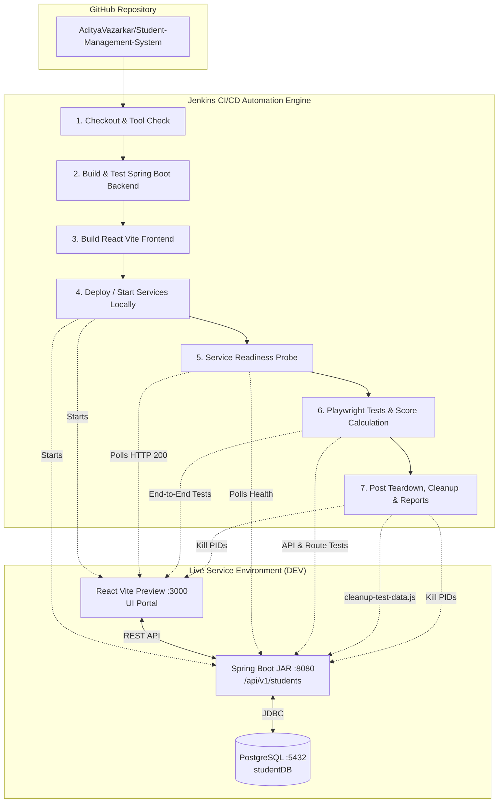
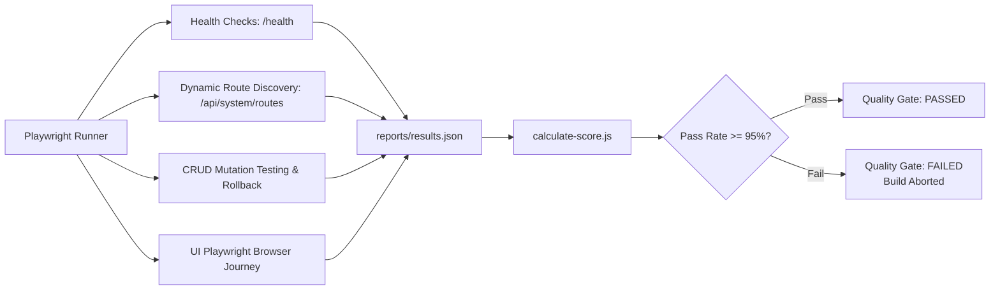
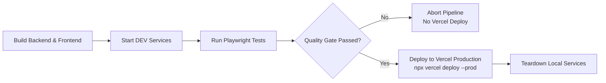

# Complete End-to-End CI/CD & Deployment Guide: Student Management System

This document provides a comprehensive, production-grade guide covering the complete deployment lifecycle of the **Student Management System** across local environments and Jenkins CI/CD automation.

---

## 📑 Table of Contents
1. [System Architecture Overview](#1-system-architecture-overview)
2. [Prerequisites & System Setup](#2-prerequisites--system-setup)
3. [Database Configuration (PostgreSQL)](#3-database-configuration-postgresql)
4. [Local Manual Deployment Workflow](#4-local-manual-deployment-workflow)
5. [Jenkins CI/CD Server Configuration](#5-jenkins-cicd-server-configuration)
6. [Jenkins Pipeline Job Setup (Step-by-Step)](#6-jenkins-pipeline-job-setup-step-by-step)
7. [Automated Pipeline Execution Lifecycle](#7-automated-pipeline-execution-lifecycle)
8. [Post-Release Verification & Quality Gates](#8-post-release-verification--quality-gates)
9. [Troubleshooting & Common Issues](#9-troubleshooting--common-issues)
10. [Quick Command Reference](#10-quick-command-reference)

---

## 1. System Architecture Overview

The application comprises three core components orchestrated by Jenkins:



### Component Details

| Component | Technology | Default Port | Main Entrypoint / Artifact |
|---|---|---|---|
| **Database** | PostgreSQL 17 / 14+ | `5432` | Database: `studentDB` |
| **Backend API** | Java 21, Spring Boot 4.x, Hibernate | `8080` | `StudentRegistration/target/StudentRegistration-0.0.1-SNAPSHOT.jar` |
| **Frontend UI** | React 19, Vite 8, Lucide React | `3000` | `Frontend/dist/` (Served via `vite preview`) |
| **Post-Release Checks** | Playwright, Node.js | N/A | `SMART-STUDENT-POST-RELEASE-CHECKS/` |
| **CI/CD** | Jenkins Declarative Pipeline | `8080` / custom | `Jenkinsfile` |

---

## 2. Prerequisites & System Setup

Ensure the following runtimes are installed on your host system:

### 2.1 macOS Setup (Homebrew)
```bash
# 1. Install Java 21 LTS
brew install openjdk@21

# 2. Install Node.js (v20+ or v22+)
brew install node

# 3. Install PostgreSQL
brew install postgresql@17
brew services start postgresql@17

# 4. Install Git
brew install git

# 5. Install Jenkins LTS
brew install jenkins-lts
brew services start jenkins-lts
```

### 2.2 Verify Installations
```bash
java -version           # Must output OpenJDK 21.x
node --version          # Must output v20+ / v22+
npm --version           # Must output 10+ / 11+
psql --version          # Must output PostgreSQL 14+
git --version           # Must output 2.30+
```

---

## 3. Database Configuration (PostgreSQL)

The Spring Boot backend requires a PostgreSQL database configured with the credentials matching [application.properties](file:///Users/aditya/Desktop/Jenkins:CICD:WriteCode/StudentRegistration/src/main/resources/application.properties).

### 3.1 Verify PostgreSQL Service
```bash
pg_isready -h localhost -p 5432
```
*Expected output: `localhost:5432 - accepting connections`*

### 3.2 Create User and Database
If not already created, run the following commands in terminal:

```bash
# Connect to default postgres database
psql -U $(whoami) -d postgres

# Inside psql shell, run:
CREATE USER aditya WITH PASSWORD 'Aditya@02' SUPERUSER;
CREATE DATABASE "studentDB" OWNER aditya;
GRANT ALL PRIVILEGES ON DATABASE "studentDB" TO aditya;
\q
```

### 3.3 Verify Database Connection
```bash
psql -U aditya -d studentDB -c "\l"
```

> [!NOTE]
> Spring Boot is configured with `spring.jpa.hibernate.ddl-auto=update`. Tables (`users`, `classrooms`, `homeworks`, `submissions`) will be automatically validated and initialized upon application startup. Default admin and sample teacher accounts are seeded automatically by `DataInitializer.java`.

---

## 4. Local Manual Deployment Workflow

Follow these steps if you want to run the full stack locally without Jenkins.

### Step 4.1: Build & Start Spring Boot Backend
```bash
cd /Users/aditya/Desktop/Jenkins:CICD:WriteCode/StudentRegistration

# 1. Build and test JAR
chmod +x mvnw
./mvnw clean package

# 2. Run the application
java -jar target/StudentRegistration-0.0.1-SNAPSHOT.jar
```
*Verify API health in a new terminal:*
```bash
curl -s http://localhost:8080/api/v1/students/health
# Response: {"status":"UP","service":"Student API","timestamp":...}
```

### Step 4.2: Build & Start React Frontend
In a second terminal:
```bash
cd /Users/aditya/Desktop/Jenkins:CICD:WriteCode/Frontend

# 1. Install dependencies
npm ci

# 2. Build production assets
npm run build

# 3. Serve production preview on port 3000
npm run preview -- --port 3000 --host
# (Or run dev mode with: npm run dev)
```
*Open in browser: `http://localhost:3000`*

### Step 4.3: Run Post-Release Verification Checks
In a third terminal:
```bash
cd /Users/aditya/Desktop/Jenkins:CICD:WriteCode/SMART-STUDENT-POST-RELEASE-CHECKS

# 1. Install dependencies & browser binaries
npm ci
npx playwright install chromium

# 2. Run deployment pre-flight probe
ENVIRONMENT=dev node scripts/wait-for-deployment.js

# 3. Run all automated tests
ENVIRONMENT=dev npm run test:all

# 4. View quality score & gate result
node scripts/calculate-score.js
```

---

## 5. Jenkins CI/CD Server Configuration

### 5.1 Required Plugins
In your Jenkins dashboard (**Manage Jenkins** → **Plugins** → **Available Plugins**), ensure these plugins are installed:
1. **Pipeline** (Workflow Aggregator)
2. **JUnit Plugin** (For test reports and trend graphs)
3. **Git Plugin** (For Git checkout)
4. **HTML Publisher Plugin** (Optional, for Playwright HTML reports)

### 5.2 Global Tool Configuration
Navigate to **Manage Jenkins** → **Tools**:
1. **JDK**:
   - Name: `JDK-21`
   - JAVA_HOME: `/opt/homebrew/Cellar/openjdk@21/21.0.12/libexec/openjdk.jdk/Contents/Home` (or path returned by `/usr/libexec/java_home -v 21`)
2. **Git**:
   - Path to Git executable: `/usr/bin/git` or `/opt/homebrew/bin/git`

---

## 6. Jenkins Pipeline Job Setup (Step-by-Step)

### Step 6.1: Create New Pipeline Job
1. Click **New Item** on the Jenkins home page.
2. Enter item name: `React-SpringBoot-CICD` (or `Student-Management-System`).
3. Select **Pipeline** and click **OK**.

### Step 6.2: Enable Parameters
Under the **General** tab:
1. Check **This project is parameterized**.
2. Add **Choice Parameter**:
   - **Name**: `TARGET_ENV`
   - **Choices**:
     ```text
     DEV
     UAT
     ```
   - **Description**: Target deployment environment to verify.
3. Add **Boolean Parameter**:
   - **Name**: `RUN_FULL_REGRESSION`
   - **Default Value**: `true`
   - **Description**: Run smoke checks, API discovery, and quality scoring.

### Step 6.3: Link Pipeline to Git Repository
Scroll down to the **Pipeline** section:
- **Definition**: `Pipeline script from SCM`
- **SCM**: `Git`
- **Repository URL**: `https://github.com/AdityaVazarkar/Student-Management-System`
- **Credentials**: None (for public repository) or your GitHub Personal Access Token / SSH Key.
- **Branch Specifier**: `*/main`
- **Script Path**: `Jenkinsfile`
- Click **Save**.

---

## 7. Automated Pipeline Execution Lifecycle

The pipeline defined in [Jenkinsfile](file:///Users/aditya/Desktop/Jenkins:CICD:WriteCode/Jenkinsfile) executes 7 distinct stages:

### Stage 1: Checkout & System Verification
- Clones latest commit from `main`.
- Validates Node.js (`v26+`), npm (`11+`), and Java 21 runtime paths via `withEnv(['PATH+NODE=/opt/homebrew/bin'])`.

### Stage 2: Build & Test Backend
- Changes directory to `StudentRegistration`.
- Runs `./mvnw clean package`.
- Executes Spring Boot unit/integration tests with Surefire.
- Packages production JAR into `StudentRegistration/target/StudentRegistration-0.0.1-SNAPSHOT.jar`.

### Stage 3: Build Frontend
- Changes directory to `Frontend`.
- Executes `npm ci` for deterministic dependency resolution.
- Executes `npm run build` using Vite to compile production bundles into `dist/`.

### Stage 4: Deploy / Start Services (DEV)
- Runs conditionally when `params.RUN_FULL_REGRESSION && params.TARGET_ENV == 'DEV'`.
- Uses `JENKINS_NODE_COOKIE=dontKillMe` to prevent Jenkins' `ProcessTreeKiller` from terminating background processes when the step ends.
- Kills any existing listeners on ports `8080` and `3000` to prevent `EADDRINUSE`.
- Starts Spring Boot in background:
  ```bash
  nohup "$JAVA_HOME/bin/java" -jar StudentRegistration/target/StudentRegistration-0.0.1-SNAPSHOT.jar > backend.log 2>&1 &
  echo $! > backend.pid
  ```
- Starts Frontend preview in background:
  ```bash
  (cd Frontend && nohup ./node_modules/.bin/vite preview --port 3000 --host > ../frontend.log 2>&1 & echo $! > ../frontend.pid)
  ```

### Stage 5: Service Readiness Probe
- Runs `ENVIRONMENT=dev node scripts/wait-for-deployment.js`.
- Polls Backend Health (`http://localhost:8080/api/v1/students/health`) with retries.
- Polls Frontend Portal (`http://localhost:3000`) with retries.
- Verifies response time is within the performance threshold (<= 2000ms).

### Stage 6: Post-Release Verification & Auto-Discovery
- Ensures Playwright Chromium binary is installed: `./node_modules/.bin/playwright install chromium`.
- Runs the test suite: `playwright test`.
- Runs `node scripts/calculate-score.js` to compute quality score and enforce quality gates.

### Stage 7: Post Actions & Teardown (`post { always { ... } }`)
1. **Data Cleanup**: Runs `node scripts/cleanup-test-data.js` against the live backend to clean any test mutation data.
2. **Process Teardown**: Reads `backend.pid` and `frontend.pid`, kills the background services, and releases ports `8080` and `3000`.
3. **Test Publishing**: Parses `SMART-STUDENT-POST-RELEASE-CHECKS/reports/junit.xml` for test trends.
4. **Artifact Archiving**: Archives `backend.log`, `frontend.log`, and all reports (`reports/**`).

---

## 8. Post-Release Verification & Quality Gates

The post-release test engine dynamically audits your deployment without hardcoded test lists:



### Quality Gate Criteria ([thresholds.js](file:///Users/aditya/Desktop/Jenkins:CICD:WriteCode/SMART-STUDENT-POST-RELEASE-CHECKS/config/thresholds.js))

| Metric | Target | Fail Condition |
|---|---|---|
| **Health Check Response** | < 2,000 ms | >= 2,000 ms |
| **UI Page Load** | < 3,000 ms | >= 3,000 ms |
| **API Mutation Response** | < 1,500 ms | >= 1,500 ms |
| **Overall Pass Rate** | >= 95.0% | < 95.0% or any failed test |

---

## 9. Troubleshooting & Common Issues

### Issue 1: `Student API not ready yet (HTTP undefined)`
> [!WARNING]
> **Cause**: The Spring Boot backend failed to start or PostgreSQL is down.
> **Remedy**:
> 1. Check `backend.log` archived in the Jenkins build artifacts.
> 2. Ensure PostgreSQL is accepting connections:
>    ```bash
>    pg_isready -h localhost -p 5432
>    ```
> 3. Verify PostgreSQL credentials in [application.properties](file:///Users/aditya/Desktop/Jenkins:CICD:WriteCode/StudentRegistration/src/main/resources/application.properties) match your database user.

### Issue 2: `Student Portal UI failed readiness check after 30 attempts`
> [!WARNING]
> **Cause**: Port 3000 was already in use or the Vite preview server crashed.
> **Remedy**:
> 1. Check `frontend.log` archived in Jenkins.
> 2. Check listening ports locally:
>    ```bash
>    lsof -i :3000
>    kill -9 <PID>
>    ```

### Issue 3: Jenkins kills background processes before the probe stage
> [!NOTE]
> **Cause**: Jenkins' `ProcessTreeKiller` automatically terminates child processes spawned by shell steps.
> **Fix**: In [Jenkinsfile](file:///Users/aditya/Desktop/Jenkins:CICD:WriteCode/Jenkinsfile), the `Deploy / Start Services (DEV)` stage uses:
> ```groovy
> withEnv(['JENKINS_NODE_COOKIE=dontKillMe']) { ... }
> ```
> This is already configured in the latest pipeline code.

### Issue 4: Playwright browser missing in Jenkins
> [!NOTE]
> **Cause**: Jenkins workspace runs under a separate agent environment without cached browser binaries.
> **Fix**: [Jenkinsfile](file:///Users/aditya/Desktop/Jenkins:CICD:WriteCode/Jenkinsfile) automatically executes:
> ```bash
> ./node_modules/.bin/playwright install chromium
> ```
> before executing tests.

---

## 10. Quick Command Reference

```bash
# Check running ports
lsof -nP -iTCP -sTCP:LISTEN | grep -E '8080|3000|5432'

# Kill stale instances
lsof -ti:8080 | xargs kill -9 2>/dev/null || true
lsof -ti:3000 | xargs kill -9 2>/dev/null || true

# Test database connection
pg_isready -h localhost -p 5432

# Build backend
cd StudentRegistration && ./mvnw clean package

# Build frontend
cd Frontend && npm run build

# Run Playwright tests directly
cd SMART-STUDENT-POST-RELEASE-CHECKS && ENVIRONMENT=dev npm run test:all
```

---

## 11. Deploying Frontend to Vercel via Jenkins CI/CD

The pipeline guarantees that **no deployment to Vercel occurs unless all tests, health probes, and quality gates pass**.

### 11.1 Step 1: Obtain Vercel Access Token
1. Log in to [Vercel](https://vercel.com).
2. Go to **Account Settings** → **Tokens** (`https://vercel.com/account/tokens`).
3. Click **Create Token**:
   - Token Name: `Jenkins-CICD-Deployer`
   - Scope: Choose your account or team.
   - Expiration: Choose desired lifespan (e.g. 1 year or No expiration).
4. Copy the generated token string.

### 11.2 Step 2: Add Token to Jenkins Credentials
1. In your Jenkins dashboard, go to **Manage Jenkins** → **Credentials**.
2. Click **(global)** domain → **Add Credentials**.
3. Configure the credential:
   - **Kind**: `Secret text`
   - **Scope**: `Global`
   - **Secret**: Paste your Vercel Access Token.
   - **ID**: `VERCEL_TOKEN` *(must match exactly)*
   - **Description**: `Vercel CLI Deployment Token`
4. Click **Create**.

### 11.3 Step 3: Configure Frontend Backend API URL on Vercel
In your Vercel Project Settings (**Settings** → **Environment Variables**):
- **Key**: `VITE_API_BASE_URL`
- **Value**: Your live backend URL (e.g., `https://api.yourdomain.com/api` or your cloud API host).
- If left unset, it defaults to `http://localhost:8080/api` for local previews.

### 11.4 Step 4: Run the Pipeline
When you click **Build with Parameters** in Jenkins:
1. Ensure **`RUN_FULL_REGRESSION`** is `true` (validates all tests).
2. Ensure **`DEPLOY_TO_VERCEL`** is `true`.
3. Click **Build**.

**Execution Flow:**


---

## 12. Automated Trigger on GitHub Push (Zero-Touch CI/CD)

The pipeline is now configured to trigger automatically whenever new code is pushed to the `main` branch on GitHub—**no manual clicking on the Jenkins dashboard required**.

### How Automated Triggers Work:
The pipeline includes both push notification and background SCM polling:
```groovy
triggers {
    githubPush()
    pollSCM('H/2 * * * *')
}
```

1. **SCM Polling (`pollSCM('H/2 * * * *')`)**:
   - **Zero configuration required**: Works out-of-the-box even on a local Mac or private network behind NAT/firewall.
   - Jenkins polls GitHub every 2 minutes. When changes are detected, it starts the build immediately.
2. **GitHub Webhook (`githubPush()`) (Instant / Real-time)**:
   - For instantaneous builds upon `git push`:
     1. In GitHub repository, go to **Settings** → **Webhooks** → **Add webhook**.
     2. **Payload URL**: `http://<YOUR_JENKINS_SERVER_URL>/github-webhook/`
     3. **Content type**: `application/json`
     4. **Events**: `Just the push event`.
     5. Click **Add webhook**.

### End-to-End Zero-Touch Lifecycle:
1. Developer pushes code to GitHub: `git push origin main`.
2. Jenkins detects the new commit automatically (via webhook or SCM polling within 2 minutes).
3. Jenkins runs:
   - Java Backend build & unit tests (`mvnw clean package`)
   - React Frontend build (`npm run build`)
   - Service Readiness Probe (`wait-for-deployment.js`)
   - Playwright E2E verification & quality gate calculation (`calculate-score.js`)
4. **If any error occurs**:
   - The build stops, Vercel deployment is **aborted**, and logs are preserved.
5. **If all tests pass**:
   - The frontend is automatically deployed to Vercel production (`--prod`).
   - The live production URL is updated and displayed in the Jenkins console!


