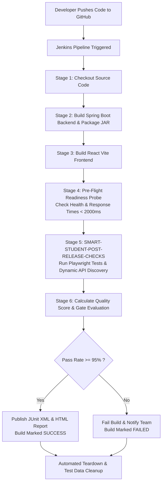

# Complete End-to-End Guide: Jenkins CI/CD Pipeline & Automated Post-Release Verification

This document provides a comprehensive, step-by-step guide explaining the complete automated CI/CD pipeline architecture, setup instructions in Jenkins, dynamic zero-config API testing, and post-release quality gating for the **Student Management System**.

---

## 📑 Table of Contents
1. [High-Level Architecture & Workflow](#1-high-level-architecture--workflow)
2. [Prerequisites & System Requirements](#2-prerequisites--system-requirements)
3. [Jenkins Server Setup & Plugin Installation](#3-jenkins-server-setup--plugin-installation)
4. [Creating the Jenkins Pipeline Job](#4-creating-the-jenkins-pipeline-job)
5. [Complete Pipeline Execution Lifecycle (Stage-by-Stage)](#5-complete-pipeline-execution-lifecycle-stage-by-stage)
6. [Dynamic Zero-Config API Auto-Discovery Explained](#6-dynamic-zero-config-api-auto-discovery-explained)
7. [Environment Guardrails: DEV, UAT & PROD](#7-environment-guardrails-dev-uat--prod)
8. [Auditable Reports & Artifacts in Jenkins](#8-auditable-reports--artifacts-in-jenkins)
9. [Local Execution & Validation Commands](#9-local-execution--validation-commands)
10. [Troubleshooting & FAQ](#10-troubleshooting--faq)

---

## 1. High-Level Architecture & Workflow



### Components Involved:
1. **GitHub Repository**: Stores application code and pipeline definitions (`https://github.com/AdityaVazarkar/Student-Management-System`).
2. **Spring Boot Backend (`StudentRegistration`)**: Java 21 REST API connected to PostgreSQL. Exposes `/api/system/routes` for dynamic route discovery.
3. **React Frontend (`Frontend`)**: Student Academic Portal & Teacher Admin Console built with React 19 and Vite.
4. **Post-Release Testing Suite (`SMART-STUDENT-POST-RELEASE-CHECKS`)**: Standalone Playwright test runner written in JavaScript (`.js`) covering Health, API, UI, and E2E journeys.
5. **Jenkins CI/CD Automation Engine**: Executes the pipeline defined in `Jenkinsfile`.

---

## 2. Prerequisites & System Requirements

Ensure the following runtimes and tools are installed on your Jenkins agent / machine:

| Component | Minimum Version | Check Command |
|---|---|---|
| **Java JDK** | OpenJDK 21 LTS | `java -version` |
| **Node.js** | Node.js v18 LTS or v20 LTS | `node -v` |
| **npm** | npm 9+ | `npm -v` |
| **PostgreSQL** | PostgreSQL 14+ | `psql -U aditya -d studentDB -c "SELECT 1;"` |
| **Git** | Git 2.30+ | `git --version` |
| **Browsers** | Chromium (Playwright) | `npx playwright install chromium` |

---

## 3. Jenkins Server Setup & Plugin Installation

### Step 3.1: Install Required Jenkins Plugins
Go to **Manage Jenkins** → **Plugins** → **Available Plugins**, search for and install:
1. **Pipeline** (Workflow aggregator)
2. **JUnit Plugin** (Enables test trend charts and JUnit XML parsing)
3. **HTML Publisher Plugin** (Enables Playwright HTML report tab directly in Jenkins)
4. **Git Plugin** (For SCM repository cloning)

### Step 3.2: Configure Tools (JDK & NodeJS)
In **Manage Jenkins** → **Tools**:
- Add **JDK 21** pointing to your Java installation path (e.g. `/opt/homebrew/Cellar/openjdk@21/...` on Mac or `/usr/lib/jvm/java-21-openjdk` on Linux).
- Add **NodeJS** pointing to Node.js v18/v20.

---

## 4. Creating the Jenkins Pipeline Job

### Step 4.1: Create a New Pipeline
1. In Jenkins dashboard, click **New Item**.
2. Enter item name: `Student-Management-System-CI-CD`.
3. Select **Pipeline** and click **OK**.

### Step 4.2: Configure General Settings & Parameters
1. Under **General**, check **This project is parameterized**.
2. Add a **Choice Parameter**:
   - **Name**: `TARGET_ENV`
   - **Choices**:
     ```text
     DEV
     UAT
     ```
   - **Description**: Target deployment environment to verify.
3. Add a **Boolean Parameter**:
   - **Name**: `RUN_FULL_REGRESSION`
   - **Default Value**: `true`
   - **Description**: Run complete smoke checks, dynamic API auto-discovery, and calculate quality gate score.

### Step 4.3: Configure Pipeline Definition
1. Scroll down to **Pipeline**.
2. Set **Definition** to **Pipeline script from SCM**.
3. Set **SCM** to **Git**.
4. Set **Repository URL**: `https://github.com/AdityaVazarkar/Student-Management-System.git`.
5. Under **Branches to build**, enter `*/main`.
6. Set **Script Path**: `Jenkinsfile`.
7. Click **Save**.

---

## 5. Complete Pipeline Execution Lifecycle (Stage-by-Stage)

When you click **Build with Parameters** and choose `DEV` or `UAT`, the pipeline executes the following stages in order:

### Stage 1: Checkout
- Clones the latest commit from `origin/main`.
- Injects environment variables (`ENVIRONMENT=dev` or `ENVIRONMENT=uat`).

### Stage 2: Build & Test Backend
- Enters `StudentRegistration/`.
- Executes `./mvnw clean package -DskipTests`.
- Compiles Spring Boot classes and packages `StudentRegistration-0.0.1-SNAPSHOT.jar`.

### Stage 3: Build Frontend
- Enters `Frontend/`.
- Executes `npm install` and `npm run build`.
- Validates that the React application compiles without syntax errors or missing dependencies.

### Stage 4: Service Readiness Probe
- Enters `SMART-STUDENT-POST-RELEASE-CHECKS/`.
- Runs `node scripts/wait-for-deployment.js`.
- **What it does:**
  1. Polls the backend health endpoint (`http://localhost:8080/api/v1/students/health`) with retries.
  2. Polls the frontend UI endpoint (`http://localhost:3000`).
  3. Verifies response times are well within the SLA (< 2000ms).
  4. If either service is unavailable, it fails fast before running tests.

### Stage 5: Post-Release Verification & Auto-Discovery
- Runs `./node_modules/.bin/playwright test`.
- Executes 4 distinct testing layers:
  1. **Layer 1 (Health):** Endpoints, database queries, and system uptime.
  2. **Layer 2 (API):** Read-only checks (`@prod-safe`), mutations with cleanup (`@write`), and Dynamic Route Auto-Discovery.
  3. **Layer 3 (UI):** Browser tests for login, role permissions, student homework tab, and teacher navigation.
  4. **Layer 4 (E2E Journeys):** Full student submission and teacher grading workflow.

### Stage 6: Quality Gate Evaluation & Scoring
- Runs `node scripts/calculate-score.js`.
- Inspects `reports/results.json`.
- Calculates pass rate:
  $$\text{Pass Rate} = \left(\frac{\text{Passed Scenarios}}{\text{Total Scenarios}}\right) \times 100$$
- **Quality Gate Rule:**
  - Pass rate $\ge 95\%$: Quality Gate passes (Rating `A+`).
  - Pass rate $< 95\%$: Quality Gate fails, terminating deployment.
- Exports `pipeline-score-summary.json` and `reports/summary.md`.

### Stage 7: Post-Build Reporting & Teardown (Always Runs)
- **JUnit Reporting:** Records `reports/junit.xml` to populate Jenkins test trend graphs.
- **HTML Report Publishing:** Publishes `reports/html/index.html` as the interactive Playwright test report.
- **Artifact Archiving:** Archives `summary.md` and `pipeline-score-summary.json`.
- **Teardown Cleanup:** Runs `node scripts/cleanup-test-data.js` to ensure any test student records are deleted from PostgreSQL.

---

## 6. Dynamic Zero-Config API Auto-Discovery Explained

### The Problem in Traditional Suites:
When developers add or modify backend APIs, QA suites fail unless someone manually writes new test cases for each new route.

### How Our Solution Solves This:
1. In the Spring Boot backend, [`SystemController.java`](file:///Users/aditya/Desktop/Jenkins:CICD:WriteCode/StudentRegistration/src/main/java/com/Student/StudentRegistration/controller/SystemController.java) reads Spring's `RequestMappingHandlerMapping` at runtime and exposes `GET /api/system/routes`.
2. In the testing suite, [`dynamic-auto-discovery.spec.js`](file:///Users/aditya/Desktop/Jenkins:CICD:WriteCode/SMART-STUDENT-POST-RELEASE-CHECKS/tests/api/dynamic-auto-discovery.spec.js):
   - Automatically calls `/api/system/routes`.
   - Discovers all 35+ active REST endpoints dynamically.
   - Issues safe automated requests against every discovered endpoint.
   - Confirms HTTP 200/201/204 status and flags any 404 or 500 regressions.
3. **Result:** New APIs added in Spring Boot are **instantly tested and scored in DEV and UAT** without editing a single line of test code.

---

## 7. Environment Guardrails: DEV, UAT & PROD

Configured in [`config/environments.js`](file:///Users/aditya/Desktop/Jenkins:CICD:WriteCode/SMART-STUDENT-POST-RELEASE-CHECKS/config/environments.js):

| Feature / Check | DEV | UAT | PROD |
|---|---|---|---|
| Read-only API checks (`@prod-safe`) | ✅ Enabled | ✅ Enabled | ✅ Enabled |
| UI Navigation & App Shell (`@ui`) | ✅ Enabled | ✅ Enabled | ✅ Enabled |
| Pre-flight Latency SLA (< 2000ms) | ✅ Enforced | ✅ Enforced | ✅ Enforced |
| Dynamic Route Discovery | ✅ Enabled | ✅ Enabled | ❌ Disabled |
| Write / Mutation Tests (`@write`) | ✅ Enabled (with auto-cleanup) | ✅ Enabled (with auto-cleanup) | 🛑 **BLOCKED (Guardrail prevents mutation)** |
| E2E Student Submission Journey | ✅ Enabled | ✅ Enabled | 🛑 **BLOCKED on live prod accounts** |

---

## 8. Auditable Reports & Artifacts in Jenkins

After each build completes in Jenkins, the following audit artifacts are generated under `SMART-STUDENT-POST-RELEASE-CHECKS/reports/`:

1. **`reports/junit.xml`**:
   - Standard XML format parsed by Jenkins.
   - Powers the **Test Result Trend** graph on the job homepage.
2. **`reports/html/index.html`**:
   - Interactive Playwright report displaying steps, screenshots on failure, and execution timings.
   - Clickable via the sidebar link: **`DEV Post-Release Verification Report`**.
3. **`reports/summary.md`**:
   - GitHub/Jenkins-flavored markdown summary table containing pass rate, SLA rating, and layer breakdown.
4. **`reports/pipeline-score-summary.json`**:
   - JSON machine-readable metrics for dashboard integrations (Datadog, Grafana, Slack bots).

---

## 9. Local Execution & Validation Commands

You can run the same checks locally before pushing code to GitHub:

### Run Complete Suite for DEV:
```bash
cd SMART-STUDENT-POST-RELEASE-CHECKS
ENVIRONMENT=dev npm run test:all
```

### Run Complete Suite for UAT:
```bash
cd SMART-STUDENT-POST-RELEASE-CHECKS
ENVIRONMENT=uat npm run test:all
```

### Run Fast Targeted Subsets:
```bash
# Critical checks only
npm run test:critical

# Production-safe read-only checks
npm run test:prod-safe

# API layer only
npm run test:api

# UI layer only
npm run test:ui

# Health probe only
node scripts/wait-for-deployment.js

# Quality score calculator only
node scripts/calculate-score.js
```

---

## 10. Troubleshooting & FAQ

### Q: Why did the Pre-Flight Readiness Probe fail?
**Cause:** Either the Spring Boot backend (port 8080) or React frontend (port 3000) is down, or response times exceeded the 2000ms threshold.  
**Fix:** Verify backend logs (`tail -f backend.log`) and ensure PostgreSQL is running (`brew services list`).

### Q: How do I change the Quality Gate pass rate threshold?
**Fix:** Open [`config/thresholds.js`](file:///Users/aditya/Desktop/Jenkins:CICD:WriteCode/SMART-STUDENT-POST-RELEASE-CHECKS/config/thresholds.js) and update `qualityGates.minPassRatePercentage` (default is `95.0`).

### Q: Does running write tests leave duplicate test students in the database?
**No.** All write checks in `student-mutations.spec.js` capture the newly generated student ID and invoke `DELETE /api/v1/students/{id}` in an `afterEach` block. Additionally, `scripts/cleanup-test-data.js` cleans up any test records in the teardown phase.
